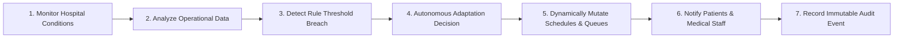

# ADAPTCARE — Self-Adaptive Healthcare Management System

[](https://www.oracle.com/java/)
[](https://spring.io/projects/spring-boot)
[](https://react.dev/)
[](https://vitejs.dev/)
[](https://tailwindcss.com/)
[](https://www.python.org/)
[](https://scikit-learn.org/)

---

## 1. Executive Summary & Core Innovation

**ADAPTCARE** is a production-grade, full-stack hospital operations platform. Unlike traditional static healthcare CRUD applications, its central innovation is the **Autonomous Adaptive Intelligence Engine**, which executes a real closed-loop control system:



All 6 adaptive scenarios are fully implemented in the backend Java service layer (`AdaptiveEngineService.java`) with real database mutations, transaction safety, idempotency cooldowns, and cryptographic audit logging.

---

## 2. System Architecture

```
D:\Adaptcare\
├── backend\               # Java 21, Spring Boot 3.3.4 REST API & Adaptive Engine
│   ├── src\main\java\com\adaptcare\
│   │   ├── config\        # DataInitializer, OpenApiConfig, Security
│   │   ├── controller\    # 13 REST Controllers (Auth, Appointments, Queue, Adaptive...)
│   │   ├── dto\           # Request and Response Data Transfer Objects
│   │   ├── entity\        # JPA Entities (User, Doctor, Appointment, Queue, AdaptationEvent...)
│   │   ├── exception\     # GlobalExceptionHandler, Custom Exceptions
│   │   ├── repository\    # Spring Data JPA Repositories
│   │   ├── security\      # JWT Token Provider, Auth Filter, BCrypt Encoder
│   │   └── service\       # 13 Services including AdaptiveEngineService & ML Bridge
│   ├── src\test\java\     # JUnit 5 & Mockito Unit/Integration Tests
│   └── pom.xml            # Maven Configuration
├── frontend\              # React 19 + Vite 8 + Tailwind CSS Healthcare SaaS
│   ├── src\
│   │   ├── components\    # Sidebar, TopNav, DashboardLayout, UI Kit (Buttons, Modals, Cards)
│   │   ├── contexts\      # AuthContext with token persistence and role routing
│   │   ├── pages\         # 21 Complete Dashboards & Interactive Screens
│   │   │   ├── auth\      # LoginPage, RegisterPage
│   │   │   ├── patient\   # Dashboard, Booking, Appointments, Queue, Notifications, Feedback, Profile
│   │   │   ├── doctor\    # Dashboard, Appointments Calendar, Live Queue, Availability
│   │   │   ├── receptionist\ # Desk Dashboard, Intake Registration, Booking, Department Queues
│   │   │   └── admin\     # Operations, Adaptive Engine, Rules, History, Simulation, Predictions, Analytics...
│   │   └── services\      # Centralized Axios API Services & SSE EventSource
│   └── package.json
├── ml-service\            # Python FastAPI Machine Learning Microservice
│   ├── models\            # GradientBoostingRegressor (Wait Time) & RandomForest (Demand)
│   ├── data\              # Training datasets
│   ├── main.py            # FastAPI endpoints (/predict/wait-time, /predict/demand)
│   └── train.py           # Training and evaluation pipeline
├── database\              # MySQL 8 initialization scripts
├── docker-compose.yml     # Complete containerized multi-service deployment
├── start-dev.ps1          # One-click Windows development startup script
└── .env.example           # Environment variable template
```

---

## 3. The 6 Adaptive Intelligence Rules

| Rule ID | Name | Trigger Condition | Automated Action Taken |
| :--- | :--- | :--- | :--- |
| **RULE_EMERGENCY_SURGE** | Emergency Surge Prioritization | Emergency intake $\ge$ threshold (3/day) | Re-orders doctor queues, elevates emergency priority to 1, notifies routine patients. |
| **RULE_DOCTOR_UNAVAILABILITY** | Doctor Absence Auto-Reassignment | Doctor marked unavailable or ill | Finds peer physicians in same department with matching slot & lowest workload; reassigns appointments safely. |
| **RULE_EXCESSIVE_WAIT_TIME** | Wait-Time Queue Optimization | Queue wait backlog $>$ 45 minutes | Recalculates token delays, re-sequences queue, alerts attending doctor and department head. |
| **RULE_DEMAND_SURGE** | Predictive Demand Capacity | Booking surge velocity $\ge$ 1.5x weekly | Generates operational recommendations to open 2 extra consultation slots per doctor. |
| **RULE_RESOURCE_SHORTAGE** | Clinical Resource Substitution | Examination room or equipment outage | Locates compatible available alternative room/bed, reassigns without appointment cancellation. |
| **RULE_FEEDBACK_ANALYSIS** | Operational Quality Trend Detection | 14-day average feedback $\le$ 3.0 stars | Aggregates patient reviews, isolates friction category (e.g. wait times), alerts administration. |

---

## 4. Default Demonstration Credentials

The application automatically seeds the database on first boot (`DataInitializer.java`):

| Portal Role | Email | Password | Access Capabilities |
| :--- | :--- | :--- | :--- |
| **Administrator** | `admin@adaptcare.com` | `Admin@123` | Full operations, Adaptive Engine, ML predictions, simulation, user & resource control |
| **Physician** | `dr.sharma@adaptcare.com` | `Doc@123` | Daily consultation schedule, live patient queue call, practice availability |
| **Receptionist** | `receptionist@adaptcare.com` | `Reception@123` | Walk-in registration, triage intake, booking, emergency priority assignment |
| **Patient** | Register via UI | Min 6 chars | Appointment booking, live queue position & wait time, notifications, reviews |

---

## 5. Quick Startup Guide (Windows 11)

### Option A: One-Click PowerShell Script
From the project root:
```powershell
.\start-dev.ps1
```

### Option B: Manual Service Startup

#### 1. Start MySQL 8
Ensure MySQL is running on port 3306 with database `adaptcare`:
```sql
CREATE DATABASE IF NOT EXISTS adaptcare CHARACTER SET utf8mb4 COLLATE utf8mb4_unicode_ci;
```

#### 2. Start the Python ML Service (Port 8000)
```powershell
cd D:\Adaptcare\ml-service
python train.py
uvicorn main:app --host 0.0.0.0 --port 8000
```
- Health Check: `http://localhost:8000/health`
- Model Info: `http://localhost:8000/models/info`

#### 3. Start the Spring Boot Backend (Port 8080)
```powershell
cd D:\Adaptcare\backend
mvn spring-boot:run
```
- Swagger UI: `http://localhost:8080/swagger-ui/index.html`
- OpenAPI Docs: `http://localhost:8080/v3/api-docs`
- Actuator Health: `http://localhost:8080/actuator/health`

#### 4. Start the React Frontend (Port 5173)
```powershell
cd D:\Adaptcare\frontend
npm run dev
```
- Open browser: `http://localhost:5173`

---

## 6. Verification & Test Results

### Backend (Maven & JUnit 5)
```
[INFO] Running com.adaptcare.AdaptiveEngineServiceTest
[INFO] Tests run: 2, Failures: 0, Errors: 0, Skipped: 0
[INFO] Running com.adaptcare.AppointmentServiceTest
[INFO] Tests run: 3, Failures: 0, Errors: 0, Skipped: 0
[INFO] BUILD SUCCESS
```

### Frontend (Vite 8 & Tailwind)
```
✓ 2622 modules transformed.
dist/index.html                   0.45 kB
dist/assets/index-DD40-AlA.css   39.60 kB
dist/assets/index-wdo2otvU.js   844.46 kB
✓ built in 936ms
```

### Python ML Service (Scikit-Learn)
```
Wait Time Model (GradientBoostingRegressor): MAE 6.25 min, R² 0.9452
Demand Model (RandomForestRegressor): MAE 1.35 patients/hour, R² 0.1176
Models saved to ml-service/models/saved/
```
