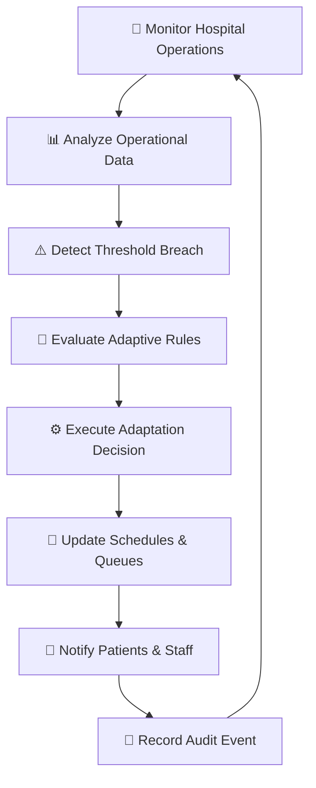
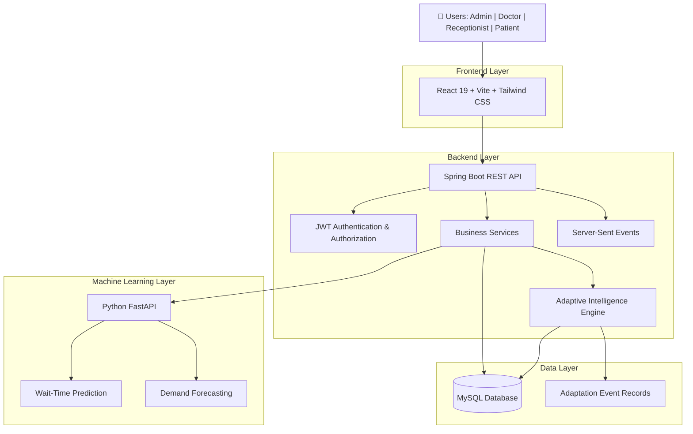

# 🏥 ADAPTCARE
### Self-Adaptive Healthcare Management System
**Intelligent Hospital Operations • Predictive Analytics • Autonomous Adaptation**

<p align="center">
  
  
  
  
  
  
  
  
</p>

---

## 🌟 Overview

**ADAPTCARE** is a full-stack, intelligent healthcare management platform designed to transform traditional hospital operations into a proactive, predictive, and self-adaptive ecosystem.

Unlike conventional hospital management systems that primarily depend on manual intervention, ADAPTCARE introduces an **Autonomous Adaptive Intelligence Engine** that continuously monitors hospital operations, identifies operational disruptions, evaluates predefined conditions, and automatically executes corrective actions.

The platform combines modern web technologies, microservice-based machine learning integration, real-time notifications, and rule-driven automation to improve hospital efficiency, patient experience, and resource utilization.

### 💡 What Makes ADAPTCARE Different?

- **Self-Adaptive Intelligence:** Automatically responds to changing hospital conditions.
- **Predictive Analytics:** Uses machine learning to estimate patient waiting times and hospital demand.
- **Real-Time Operations:** Provides live queue updates and notifications.
- **Intelligent Resource Allocation:** Supports automated appointment and resource reassignment.
- **Role-Based Management:** Dedicated interfaces for administrators, doctors, receptionists, and patients.
- **Auditability:** Records adaptation events for operational transparency.

---

## 🧠 Core Innovation — Autonomous Adaptive Intelligence Engine

At the heart of ADAPTCARE is an intelligent closed-loop adaptation mechanism.

Instead of simply displaying operational problems, the system detects predefined operational conditions and executes appropriate corrective actions.

### Adaptive Control Workflow



**Key implementation:** `AdaptiveEngineService.java`

The backend implements six adaptive scenarios with database mutations, transaction management, cooldown-based duplicate prevention, and audit-event recording.

---

## ⚡ Six Intelligent Adaptive Scenarios

| Rule | Operational Condition | Automated Response |
|---|---|---|
| Emergency Surge Prioritization | Emergency intake reaches the configured threshold | Prioritizes emergency patients and reorganizes queues |
| Doctor Unavailability | A doctor becomes unavailable | Identifies suitable alternative doctors and reassigns appointments |
| Excessive Waiting Time | Queue waiting time exceeds 45 minutes | Optimizes queue sequencing and recalculates delays |
| Predictive Demand Surge | Booking velocity reaches the configured threshold | Recommends additional consultation capacity |
| Resource Shortage | Examination room or equipment becomes unavailable | Identifies compatible alternative resources |
| Feedback Trend Detection | 14-day average feedback falls to 3 stars or below | Identifies operational issues and alerts administrators |

---

## 🏗️ System Architecture

ADAPTCARE follows a modular architecture consisting of three major application layers.



### Technology Stack

| Layer | Technologies |
|---|---|
| Frontend | React 19, Vite 8, Tailwind CSS |
| Backend | Java 21, Spring Boot 3.3.4 |
| API | REST APIs, Spring Data JPA |
| Security | Spring Security, JWT, BCrypt |
| Database | MySQL 8 |
| Machine Learning | Python 3.12, Scikit-Learn |
| ML Framework | FastAPI |
| Predictions | Gradient Boosting, Random Forest |
| Real-Time Communication | Server-Sent Events (SSE) |
| API Documentation | Swagger / OpenAPI |
| Containerization | Docker, Docker Compose |
| Testing | JUnit 5, Mockito |

---

## 📂 Project Structure

```text
ADAPTCARE/
│
├── backend/
│   ├── src/
│   │   ├── main/
│   │   │   ├── java/com/adaptcare/
│   │   │   │   ├── config/
│   │   │   │   ├── controller/
│   │   │   │   ├── dto/
│   │   │   │   ├── entity/
│   │   │   │   ├── exception/
│   │   │   │   ├── repository/
│   │   │   │   ├── security/
│   │   │   │   └── service/
│   │   │   └── resources/
│   │   └── test/
│   └── pom.xml
│
├── frontend/
│   ├── public/
│   ├── src/
│   │   ├── assets/
│   │   ├── components/
│   │   ├── contexts/
│   │   ├── pages/
│   │   │   ├── admin/
│   │   │   ├── auth/
│   │   │   ├── doctor/
│   │   │   ├── patient/
│   │   │   └── receptionist/
│   │   ├── services/
│   │   └── utils/
│   └── package.json
│
├── ml-service/
│   ├── models/
│   ├── data/
│   ├── main.py
│   ├── schemas.py
│   ├── train.py
│   └── requirements.txt
│
├── database/
│   └── init.sql
│
├── docker/
│
├── docker-compose.yml
├── start-dev.ps1
├── .env.example
├── .gitignore
└── README.md
```

---

## 👥 Role-Based Dashboards

ADAPTCARE provides dedicated interfaces with role-specific functionality.

| User Role | Main Capabilities |
|---|---|
| 👨‍💼 Administrator | Hospital operations, adaptive rules, simulation, predictions, analytics, resource management |
| 👨‍⚕️ Doctor | Appointment management, live patient queues, availability management |
| 🧑‍💻 Receptionist | Patient registration, appointment booking, triage and queue management |
| 🧑‍🤝‍🧑 Patient | Appointment booking, queue tracking, notifications, feedback and profile management |

---

## 🤖 Machine Learning Integration

ADAPTCARE integrates a dedicated Python FastAPI microservice to provide predictive intelligence.

### 1. Patient Waiting-Time Prediction

- Model: GradientBoostingRegressor
- Purpose: Estimate patient waiting times.
- Reported MAE: 6.25 minutes
- Reported R²: 0.9452

### 2. Hospital Demand Prediction

- Model: RandomForestRegressor
- Purpose: Estimate patient demand per hour.
- Reported MAE: 1.35 patients/hour
- Reported R²: 0.1176

**ML Service Endpoints**

| Endpoint | Purpose |
|---|---|
| `/health` | Service health check |
| `/models/info` | Model information |
| `/predict/wait-time` | Waiting-time prediction |
| `/predict/demand` | Demand prediction |

---

## 🔐 Security Features

- JWT-based authentication.
- Role-based access control.
- BCrypt password hashing.
- Protected API endpoints.
- Centralized exception handling.
- Environment-based configuration.
- Adaptation event audit records.

**Security Note:** Demo credentials are intended only for local development. Replace default passwords and secrets before deployment. Never commit your actual `.env` file.

---

## 🚀 Getting Started

### Prerequisites

Install the following:

- Java 21
- Maven
- Node.js and npm
- Python 3.12
- MySQL 8
- Docker (optional)

### 1. Clone the Repository

```bash
git clone https://github.com/hemalatha2205/ADAPTCARE.git
cd ADAPTCARE/Adaptcare
```

### 2. Configure Environment Variables

Create your local `.env` using `.env.example` as a reference.

Update database credentials and other required configuration values.

### 3. Initialize MySQL

```sql
CREATE DATABASE IF NOT EXISTS adaptcare
CHARACTER SET utf8mb4
COLLATE utf8mb4_unicode_ci;
```

### 4. Start the Machine Learning Service

```powershell
cd ml-service

python -m venv venv
.\venv\Scripts\activate

pip install -r requirements.txt

python train.py

uvicorn main:app --host 0.0.0.0 --port 8000
```

### 5. Start the Spring Boot Backend

Open another terminal:

```powershell
cd backend

mvn spring-boot:run
```

Backend URL: `http://localhost:8080`

Swagger UI: `http://localhost:8080/swagger-ui/index.html`

### 6. Start the React Frontend

Open another terminal:

```powershell
cd frontend

npm install

npm run dev
```

Frontend URL: `http://localhost:5173`

### 7. Docker Deployment

The project also includes Docker configuration for containerized development.

```powershell
docker compose up --build
```

Ensure your environment variables and Docker service configuration are set up before running this command.

---

## 🧪 Testing & Verification

### Backend Testing

Testing framework: JUnit 5 and Mockito.

Reported test results:

| Test Class | Tests | Failures |
|---|---:|---:|
| AdaptiveEngineServiceTest | 2 | 0 |
| AppointmentServiceTest | 3 | 0 |
| **Total** | **5** | **0** |

### Frontend Build

Reported production build:

- 2,622 modules transformed.
- Build completed successfully.
- Vite production bundle generated.

### Machine Learning Evaluation

| Model | MAE | R² |
|---|---:|---:|
| Gradient Boosting | 6.25 | 0.9452 |
| Random Forest | 1.35 | 0.1176 |

*Results reflect the reported development evaluation and are not independent clinical validation.*

---

## 🔮 Future Enhancements

- Advanced predictive hospital resource allocation.
- More sophisticated demand forecasting.
- Enhanced anomaly detection.
- Multi-hospital support.
- Advanced operational analytics.
- Cloud-native deployment and orchestration.
- Improved monitoring and observability.

---

## 🎯 Project Impact

ADAPTCARE aims to move hospital management beyond traditional record keeping toward intelligent operational decision-making.

By combining autonomous adaptation, machine learning, real-time communication, and role-based workflows, the system provides a foundation for more responsive and efficient healthcare operations.

**The core idea is simple: Don't just monitor hospital problems. Detect them, adapt to them, and respond intelligently.**

---

## 👩‍💻 Project Information

**Project Name:** ADAPTCARE – Self-Adaptive Healthcare Management System

**Repository:** [GitHub – ADAPTCARE](https://github.com/hemalatha2205/ADAPTCARE)

**Primary Technologies:** Java, Spring Boot, React, Python, FastAPI, Scikit-Learn, MySQL

---

<p align="center">
  <b>ADAPTCARE — Making Healthcare Operations Smarter, Faster & Adaptive.</b>
  <br/>
  <i>Intelligence that adapts. Technology that cares.</i>
</p>
